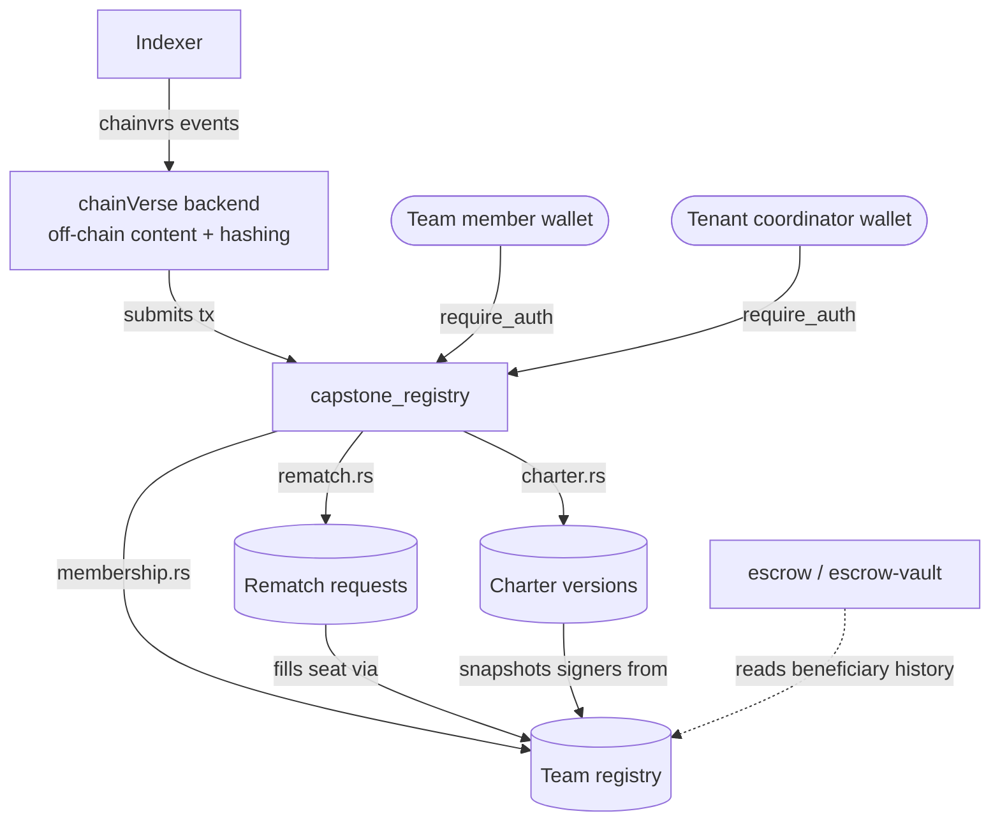

# Capstone Workspace — On-chain Design

> **Status: design specification.** No capstone contract exists on `main` yet
> (revalidated against `ac5442d`, 2026-11-20). These documents describe the
> on-chain contract to be built for the work items below. Field names, limits
> and error codes are proposals. Change them here before or alongside the code.

| Work item | Track | Document | Issue |
| --- | --- | --- | --- |
| CAPSTONE-047 | Teams | [Team membership changes](./team-membership.md) | #1395 |
| CAPSTONE-048 | Teams | [Team rematching workflow](./team-rematching.md) | #1396 |
| CAPSTONE-049 | Governance | [Project charters](./project-charters.md) | #1397 |

## 1. Where this fits

The capstone and research-project workspace mostly runs **off-chain**: the
chainVerse backend holds proposals, profiles, chat, files and review content.
This repository adds only the small set of primitives that benefit from a public,
tamper-evident ledger:

- **Registry.** Who is on a project team, in which role, and since when.
- **Commitments.** Hashes of off-chain documents (charters, continuity plans,
  skill-gap descriptions), so any party can later prove which version was agreed.
- **Attestations.** Signed consent from members (joining, accepting a successor,
  signing a charter).
- **Escrow and settlement links.** Read-only references that existing escrow or
  reward records can point at. These docs do **not** move funds.

All three work items are implemented in one proposed crate:

```
contracts/capstone_registry/
  src/lib.rs          # contract entrypoints
  src/membership.rs   # CAPSTONE-047
  src/rematch.rs      # CAPSTONE-048
  src/charter.rs      # CAPSTONE-049
  src/storage.rs      # versioned DataKey, TTL helpers
  src/errors.rs       # CapstoneError (codes 100–399)
  src/events.rs       # event emitters
  src/test/           # deterministic tests (one module per item)
```

A single contract keeps the cross-checks atomic. Rematching fills a seat through
the membership logic, and charters snapshot the active member set. Splitting
them into separate contracts would need cross-contract calls and would leave
windows where the two sides disagree.



## 2. Shared model

### 2.1 Tenants and projects

- `tenant_id: BytesN<32>` is an opaque identifier for an institution or cohort.
  It is derived off-chain (for example, `sha256("tenant:" || internal_uuid)`), so
  the ledger shows no organization names.
- Each tenant has one or more **coordinator** addresses, registered by the
  contract admin with `set_coordinator(tenant_id, addr, enabled)`.
- `project_id: BytesN<32>` is opaque in the same way. Every project record is
  keyed by `(tenant_id, project_id)`, and every entrypoint takes both.
- **Tenant boundary rule:** a coordinator for tenant A gets `Unauthorized` on any
  record under tenant B, even if they know the project id. Records are never
  looked up by `project_id` alone.

### 2.2 Authorization (deny by default)

Every state-changing entrypoint:

1. Calls `require_auth()` on the acting address. The address is an explicit
   argument and is never inferred.
2. Loads the actor's capability for `(tenant_id, project_id)` (contract admin,
   tenant coordinator, team lead, active member, or invitee).
3. Checks the action against a fixed allow-list for that capability. Anything
   not listed returns `Unauthorized` (shared code `1`).

The contract admin can manage coordinators, pause the contract and upgrade it.
It **cannot** act as a team member or sign on anyone's behalf.

### 2.3 Privacy boundary

| On-chain (public) | Off-chain only (backend) |
| --- | --- |
| Opaque tenant and project ids | Names of institutions, projects, people |
| Member `Address`, role enum, status enum, timestamps | Email, profile, skills, CV, reasons for leaving |
| `BytesN<32>` content hashes | The documents those hashes commit to |
| Charter section hashes and accepted term version numbers | Charter text, funding breakdowns, IP and data terms |
| `reason_code: u32` (coarse enum) | Free-text reasons, safety or conduct reports |
| Amount caps only where escrow needs them | Budgets, invoices, bank details |

Rules:

- **Salted commitments.** Every hash is `sha256(domain_tag || salt_32 || canonical_json)`.
  The backend keeps the salt so that short or guessable documents cannot be
  brute-forced from the hash. Domain tags are listed in each feature doc.
- **No free text on-chain.** No `String` or `Bytes` arguments are accepted, apart
  from fixed-size hashes.
- **Coarse reason codes.** `reason_code` values are deliberately coarse (for
  example `VOLUNTARY`, `SCHEDULE`, `COORDINATOR_DECISION`). Conduct or safety
  removals use the generic `COORDINATOR_DECISION`, so the ledger never flags a
  person as the subject of a conduct case.
- **Events carry ids, enums, addresses and hashes only.**

### 2.4 Idempotency and concurrency

Two mechanisms apply to every mutating call:

- **`request_id: BytesN<32>`** is generated by the client per logical action.
  The contract stores `(actor, request_id) → sha256(args)` in temporary storage
  with a TTL of about 7 days.
  - Same id, same args: returns `Ok` with the original result. No state change,
    no event.
  - Same id, different args: returns `RequestIdConflict` (101).
- **`expected_version: u32`** is the version of the record (team, request or
  charter) the client last read. Every mutation increments it. A mismatch returns
  `StaleVersion` (102), and the client must re-read before retrying.

Together these make retries safe and stop two coordinators racing on the same
team. Soroban runs transactions in order, so the second writer always sees the
first writer's version bump.

### 2.5 Time and expiry

- All times are `env.ledger().timestamp()` (u64 seconds). Ledger sequence is not
  used for business times.
- Each feature defines maximum windows: invitation TTL, maximum
  future-effective date, signature window. Expired items are rejected lazily on
  access, with `Expired` (103). Anyone can also sweep them with a permissionless
  `expire_*` call, which emits an event but cannot change any outcome other than
  marking the item expired.

### 2.6 Storage bounds

| Item | Bound | Storage type |
| --- | --- | --- |
| Members per team (all statuses retained) | 24 records, 12 non-terminal | persistent |
| Pending scheduled changes per team | 8 | persistent |
| Open rematch requests per team | 2 | persistent |
| Invitations per rematch request | 3 | persistent |
| Charter sections | 12 fixed slots | persistent |
| Accepted term versions per charter | 8 | persistent |
| Charter versions retained per project | 16 | persistent |
| Idempotency keys | unbounded count, 7-day TTL | temporary |

Exceeding a bound returns `LimitExceeded` (104). Persistent entries are bumped
to a TTL of at least 180 days on every write. The backend runs a monthly
TTL-extension job for active projects.

### 2.7 Error codes

Shared codes `1`–`7` stay in `shared::ContractError`, and `1 Unauthorized` and
`6 ContractPaused` are reused. Capstone-specific errors live in
`CapstoneError` (`#[contracterror]`, `u32`). The numbers are **stable and must
never be renumbered**.

| Range | Owner |
| --- | --- |
| 100–199 | Common (see below) |
| 200–249 | Membership (CAPSTONE-047) |
| 250–299 | Rematching (CAPSTONE-048) |
| 300–349 | Charters (CAPSTONE-049) |

| Code | Name | Meaning / client action |
| --- | --- | --- |
| 100 | `NotInitialized` | Contract has not been initialized. Deploy step missing. |
| 101 | `RequestIdConflict` | `request_id` was reused with different arguments. Generate a new id. |
| 102 | `StaleVersion` | `expected_version` is out of date. Re-read the record and retry. |
| 103 | `Expired` | Deadline passed. Start a new request or invitation. |
| 104 | `LimitExceeded` | A storage bound was hit. Close or remove older items first. |
| 105 | `TenantMismatch` | Record exists under a different tenant. Treat as not found. |
| 106 | `NotFound` | No such record under this tenant and project. |
| 107 | `InvalidTransition` | Action not allowed from the record's current state. |
| 108 | `InvalidArgument` | Out-of-range enum, zero hash, or bad time window. |

### 2.8 Events

The existing emitters use `symbol_short!` (9 characters or fewer), so the logical
topic `chainverse:{domain}:{event}` is published as
`(symbol_short!("chainvrs"), symbol_short!(domain), symbol_short!(event))`.
Every payload starts with `(schema_version: u32, tenant_id, project_id, ...)`, so
indexers can handle schema changes. Each feature doc lists its events.

### 2.9 Upgrades

- `DataKey` is a versioned enum. New variants are append-only, and existing
  variants are never reordered or repurposed.
- Instance storage holds `SCHEMA_VERSION: u32`, starting at `1`.
- `upgrade(new_wasm_hash)` is admin-only and calls
  `env.deployer().update_current_contract_wasm`. Migrations run lazily on read,
  through a `migrate_vN_to_vN+1` helper, so no unbounded loop is needed.
- An upgrade-compatibility test writes records with the v1 wasm, upgrades, and
  checks that they read back unchanged and that the error codes are unchanged.

## 3. Shared test requirements

All tests are deterministic. They use a fixed `env.ledger().set_timestamp(..)`,
`Address::generate`, and no randomness or wall clock. Each feature module covers
the categories below. Each feature doc lists its specific cases.

| Category | Technique |
| --- | --- |
| Authorization trees | `env.auths()` asserted against the expected `AuthorizedInvocation` tree; `mock_auths` with the wrong signer must fail |
| Replay resistance | Same `request_id` twice gives one state change and one event; same id with changed args gives 101 |
| State transitions | Table-driven: every (state, action) pair, with the expected result or error code |
| Expiry | Advance the ledger timestamp across each deadline boundary (t−1, t, t+1) |
| Storage bounds | Fill to bound, check that bound+1 returns 104 |
| Event schemas | Assert topics and payload tuples exactly; assert no hash preimage or free text |
| Error codes | Assert the numeric value of every `CapstoneError` variant (protects against renumbering) |
| Resource budgets | `env.budget().reset_default()`, then assert CPU and memory under thresholds for the worst-case call |
| Upgrade compatibility | Install v1, write data, upgrade to the test v2 wasm, read back |

## 4. Rollout and rollback

1. **Testnet.** Deploy, register one pilot tenant's coordinators, and run the
   backend in shadow mode. The backend writes on-chain but still treats its own
   database as the source of truth, and an indexer job reconciles the two.
2. **Mainnet, pilot tenants.** The backend flag `capstone_onchain_enabled` is set
   per tenant.
3. **General availability.** The on-chain registry becomes authoritative for
   membership history and charter agreement.

Rollback:

- **Pause.** The admin calls `set_paused(true)`, and every mutating call returns
  `ContractPaused` (6). Reads keep working, so history stays verifiable.
- **Backend fallback.** Turn the per-tenant flag off. The backend resumes
  database-only operation and queues intents for replay. Because each intent
  reuses its `request_id`, replaying it after unpausing cannot create duplicates.
- **Bad upgrade.** Re-run `upgrade` with the previous wasm hash. This is safe
  because migrations are additive and the old code ignores unknown keys.
- **No deletion.** Records cannot be deleted. Ledger history is permanent, which
  is why only hashes and enums are ever written.

## 5. Dependencies

- `soroban-sdk = 20.5.0` (workspace).
- `shared` crate: `ContractError`, event helpers.
- **Backend:** canonical JSON serialization and salted hashing, salt custody,
  transaction submission with `request_id` generation, the indexer, and TTL
  extension jobs.
- **Wallets:** members and coordinators sign their own authorizations. The
  backend may pay fees as the transaction source, but it cannot authorize on
  their behalf.

## 6. Corresponding work in other repositories

Each CAPSTONE item also has backend (API, persistence, hashing) and frontend
(UI) counterparts. The exact repository names and issue numbers should be filled
in when they are known.

| Item | Backend counterpart (expected) | Frontend counterpart (expected) |
| --- | --- | --- |
| CAPSTONE-047 | Membership API, effective-date scheduler, history views, tx submission | Team roster, join/leave/role/substitute flows, wallet signing |
| CAPSTONE-048 | Rematch request queue, coordinator review, skill-gap and continuity-plan storage + hashing, invitations | Request form, coordinator review screen, successor invite/accept, consent prompts |
| CAPSTONE-049 | Charter editor storage, section canonicalization + hashing, terms-version catalogue | Charter editor, review/diff, multi-member signing |
