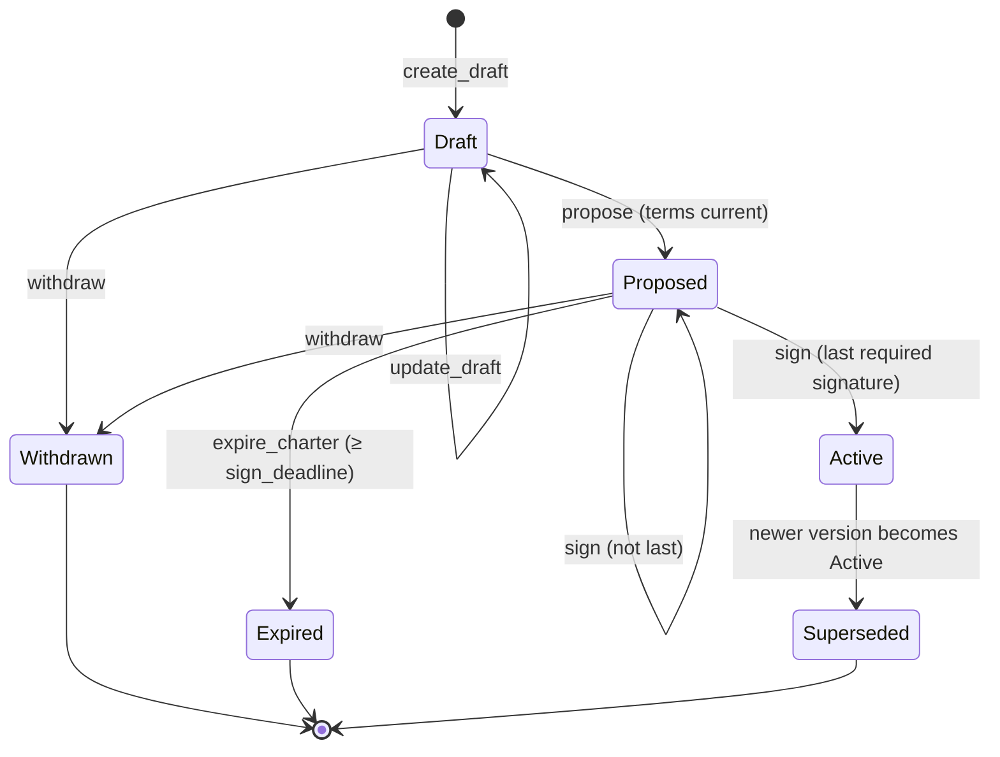

# CAPSTONE-049 — Project Charters

> Design specification for issue #1397 (Governance track). Read the
> [capstone overview](./README.md) and [CAPSTONE-047](./team-membership.md)
> first.

## 1. Goal

A charter records the agreement a team makes about its project:

- scope
- outcomes
- roles
- governance
- communication
- timeline
- funding
- intellectual property
- data handling
- publication
- conduct
- the accepted platform **term versions**

The charter text lives off-chain. On-chain, the contract stores a **versioned
commitment** to it, plus each required signer's attestation. Anyone holding a
charter document can then prove that it is exactly the version the team
signed.

## 2. Data model

```rust
/// Fixed section slots. Order and numbering are permanent.
#[contracttype]
pub enum Section {
    Scope = 0, Outcomes = 1, Roles = 2, Governance = 3, Communication = 4,
    Timeline = 5, Funding = 6, Ip = 7, Data = 8, Publication = 9,
    Conduct = 10, Terms = 11,
}

#[contracttype]
pub enum CharterStatus {
    Draft = 0,       // hashes editable by Lead
    Proposed = 1,    // frozen; collecting signatures
    Active = 2,      // all required signers signed
    Superseded = 3,  // terminal; a later version became Active
    Withdrawn = 4,   // terminal; Draft/Proposed abandoned
    Expired = 5,     // terminal; signature window passed
}

#[contracttype]
pub struct TermsAcceptance {
    pub terms_id: u32,      // catalogue id, e.g. 1 = Platform ToS, 2 = Research Data Policy
    pub version: u32,       // catalogue version accepted
}

#[contracttype]
pub struct Charter {
    pub version: u32,                        // charter version number, 1-based
    pub status: CharterStatus,
    pub content_hash: BytesN<32>,            // hash of the whole canonical document
    pub section_hashes: Vec<BytesN<32>>,     // exactly 12, indexed by Section
    pub terms: Vec<TermsAcceptance>,         // ≤ 8, strictly increasing terms_id
    pub funding_cap: Option<i128>,           // optional public cap, see §5
    pub required_signers: Vec<Address>,      // snapshot of Active members at propose
    pub signatures: Vec<(Address, u64)>,     // signer, timestamp
    pub proposed_at: Option<u64>,
    pub sign_deadline: Option<u64>,          // proposed_at + 14d
    pub activated_at: Option<u64>,
    pub record_version: u32,                 // expected_version target
}

DataKey::Charter(tenant_id, project_id, version)   -> Charter
DataKey::CharterHead(tenant_id, project_id)        -> (latest_version, active_version: Option<u32>)
DataKey::TermsCatalogue(tenant_id, terms_id)       -> u32 (current version)
```

### Hashing (off-chain, canonical)

```
section_hash[i] = sha256("chainverse:capstone:charter:section:v1" || salt_i || i_u8 || canonical_json(section_i))
content_hash    = sha256("chainverse:capstone:charter:v1" || project_id || version_u32 || section_hash[0] || … || section_hash[11] || canonical(terms))
```

- **Per-section salts.** Each section has its own salt. A team can then reveal one
  section to a third party (for example, the IP section to a funder) without
  revealing the rest.
- **Empty sections.** An empty section hashes an empty JSON object. A zero hash is
  rejected, so every section is an explicit choice.
- **Pinned content hash.** `content_hash` binds the project and version, so a
  signature cannot be replayed onto another project's or version's charter.

## 3. Entrypoints

Every mutating call takes `tenant_id`, `project_id`, `request_id` and
`expected_version`, which is the target charter's `record_version`.

| Function | Args | Must authorize | Allowed when |
| --- | --- | --- | --- |
| `set_terms_version` | `coordinator, terms_id, version` | coordinator | Version is greater than the current one (monotonic) |
| `create_draft` | `lead, content_hash, section_hashes, terms, funding_cap` | Lead (active) | No other `Draft` or `Proposed` version for this project |
| `update_draft` | `lead, version, content_hash, section_hashes, terms, funding_cap` | Lead | `Draft` |
| `propose` | `lead, version` | Lead | `Draft`. Every `terms` entry equals the **current** catalogue version. |
| `sign` | `signer, version, content_hash` | signer | `Proposed`, `now < sign_deadline`, signer is in `required_signers` and has not signed, `content_hash` matches |
| `withdraw` | `actor, version` | Lead or coordinator | `Draft` or `Proposed` |
| `expire_charter` | `version` | anyone | `Proposed` and `now ≥ sign_deadline` |
| `get_charter`, `get_active`, `verify_section` | — | none (read) | — |

### Signing details

- **`sign` repeats the content hash.** The signer passes the `content_hash` they
  reviewed. If it does not match the stored hash, the call fails with
  `ContentMismatch` (302). This prevents signing a document that differs from
  the one the signer saw.
- **Activation.** When the last required signature arrives, the same call:
  - sets the version to `Active` and `activated_at = now`;
  - sets the previous `Active` version, if any, to `Superseded`;
  - updates `CharterHead`.
- **Amendments.** An amendment is a new version created with `create_draft`
  while one is `Active`. The old charter stays in force until the new one is
  fully signed, so there is never a gap with no governing charter.

### Membership changes while `Proposed`

`required_signers` is snapshotted at `propose`. If membership changes before
activation (see [CAPSTONE-047](./team-membership.md)):

- A signer who leaves or is removed makes `sign` by other members still possible,
  but `propose` validity is checked at activation. If any required signer is no
  longer `Active`, activation fails with `SignerSetChanged` (304). The Lead must
  withdraw and re-propose.
- New members are not required signers of an in-flight version. The Lead
  re-proposes if they need to be included.

This keeps the rule simple and auditable: **an Active charter was signed by
exactly the active team at the moment it took effect.**

## 4. Terms versions

- Each tenant's coordinator publishes catalogue versions with
  `set_terms_version`, for example "Platform Terms v4" or "Research Data Policy
  v2". The ids and versions are just numbers. The text and its hash live in the
  backend terms catalogue.
- **Stale terms.** `propose` rejects a draft that references a stale version
  with `StaleTermsVersion` (303).
- **Active charters do not expire.** A charter that is already `Active` does not
  become invalid when a catalogue version changes. The backend uses
  `get_active(..).terms` to see which teams need to amend, and the frontend
  prompts them.

## 5. Funding section

- The funding **details** (budget lines, sponsors, payment schedule) are in the
  `Funding` section hash only.
- `funding_cap: Option<i128>` is an **optional, public** upper bound. Set it only
  when an escrow or payout contract needs to enforce one. It defaults to `None`.
  If it is set, it must be ≥ 0. This contract does not hold or move tokens, and
  linking a cap to escrow is a separate change.

## 6. State machine



`Active` has no direct exit except `Superseded`. Withdrawing an active charter
without a replacement is intentionally impossible. **Open question:** should a
coordinator be able to put a charter into a `Suspended` state for disputes?
That is deferred.

## 7. Errors (300–349)

| Code | Name | Client action |
| --- | --- | --- |
| 300 | `DraftInProgress` | Another Draft or Proposed version exists. Finish or withdraw it. |
| 301 | `NotRequiredSigner` | Signer is not in the snapshot for this version. |
| 302 | `ContentMismatch` | The document you reviewed differs from the proposed one. Reload. |
| 303 | `StaleTermsVersion` | Update the draft to the current terms versions. |
| 304 | `SignerSetChanged` | Team changed since propose. Withdraw and re-propose. |
| 305 | `AlreadySigned` | No action needed. |
| 306 | `InvalidSections` | There must be exactly 12 non-zero section hashes, and terms must be sorted and unique. |
| 307 | `VersionLimit` | 16 versions retained per project. Contact a coordinator. |

The common errors 1, 6 and 100–108 also apply.

## 8. Events

The topic is `(chainvrs, charter, …)`. The payload prefix is
`(schema_version, tenant_id, project_id, version)`.

| Event | Payload suffix |
| --- | --- |
| `drafted` | `(lead, content_hash)` |
| `updated` | `(content_hash)` |
| `proposed` | `(content_hash, required_signer_count, sign_deadline)` |
| `signed` | `(signer, signed_count)` |
| `active` | `(content_hash, superseded_version: Option<u32>)` |
| `withdrawn` | `(actor)` |
| `expired` | `(signed_count)` |
| `terms` | `(terms_id, version)`; the payload prefix here has no project or version |

Section hashes are **not** emitted, to keep events small. They can be read with
`get_charter`.

## 9. Off-chain boundaries

| Concern | Lives in | On-chain trace |
| --- | --- | --- |
| Charter text for all 12 sections | Backend document store | `section_hashes`, `content_hash` |
| Section salts | Backend, project-scoped secret | none |
| Budgets, sponsors, payment schedules | Backend | `Funding` section hash; optional `funding_cap` |
| IP ownership split, licences | Backend | `Ip` section hash |
| Data management plan, consent forms, ethics approvals | Backend | `Data` section hash |
| Terms text | Backend terms catalogue | `(terms_id, version)` |
| Editing history between drafts | Backend | only the latest draft hash |
| Selective disclosure to third parties | Backend gives the section JSON + salt; verifier calls `verify_section` | read-only call |

`verify_section(tenant, project, version, section, candidate_hash) -> bool` lets
an external party check a revealed section without the backend being involved.

## 10. Test plan (`src/test/charter.rs`)

- **Authorization trees**
  - `create_draft` by a non-Lead member fails with 1.
  - `sign` by a required signer has a single-entry auth tree.
  - `set_terms_version` by a Lead fails with 1.
  - A cross-tenant coordinator gets 1 or 105.
- **Replay**
  - `sign` twice with the same `request_id` gives one `signed` event.
  - `sign` with a new `request_id` after signing returns 305.
  - A signature with another project's `content_hash` returns 302.
- **Transitions.** A table test over every `CharterStatus` × entrypoint pair.
- **Activation and supersession**
  - The last signature activates the version and supersedes the previous one in
    the same call.
  - `CharterHead` is updated.
  - The previous version stays Active until then.
- **Expiry.** Sign at `sign_deadline − 1` succeeds; at the deadline it returns
  103. `expire_charter` boundaries.
- **Terms**
  - `propose` with stale terms returns 303.
  - A catalogue bump does not change an `Active` charter.
  - A non-monotonic `set_terms_version` returns 108.
- **Membership interplay.** A required signer is removed while `Proposed`; the
  final signature then returns 304.
- **Bounds and validation**
  - 11 or 13 section hashes return 306.
  - A zero hash returns 306.
  - 9 terms return 104.
  - The 17th version returns 307.
- **Events and errors.** Exact schemas; numeric codes 300–307; no section hash in
  any event.
- **Budget.** Worst case is the final `sign` on a 12-signer charter with
  supersession.
- **Upgrade.** Active, Proposed and Superseded versions survive an upgrade.
  `verify_section` gives the same results before and after.

## 11. Rollout / rollback specifics

- **Order.** Ship after CAPSTONE-047, because it needs the active-member
  snapshot. It is independent of CAPSTONE-048.
- **Terms catalogue first.** Seed the catalogue for each tenant with
  `set_terms_version` before enabling charter creation.
- **Pause.** While paused, signature windows keep running. Affected charters can
  be re-proposed after unpausing; there is no special extension.
- **Backend fallback.** With the flag off, charters are signed off-chain only.
  When on-chain mode is turned back on, each project's current off-chain charter
  is anchored as a new on-chain version and signed again by members. There is no
  bulk import without signatures.

## 12. Dependencies and related work

- **Depends on:** [CAPSTONE-047](./team-membership.md) (Lead role, active-member
  snapshot).
- **Consumed by:** future review and publication flows (prove which IP,
  publication and data terms were agreed) and escrow (`funding_cap`, if adopted).
- **Other repositories:** backend charter editor storage, canonical JSON,
  per-section salting, terms catalogue, selective-disclosure endpoint; frontend
  charter editor, version diff, multi-member signing UI.
