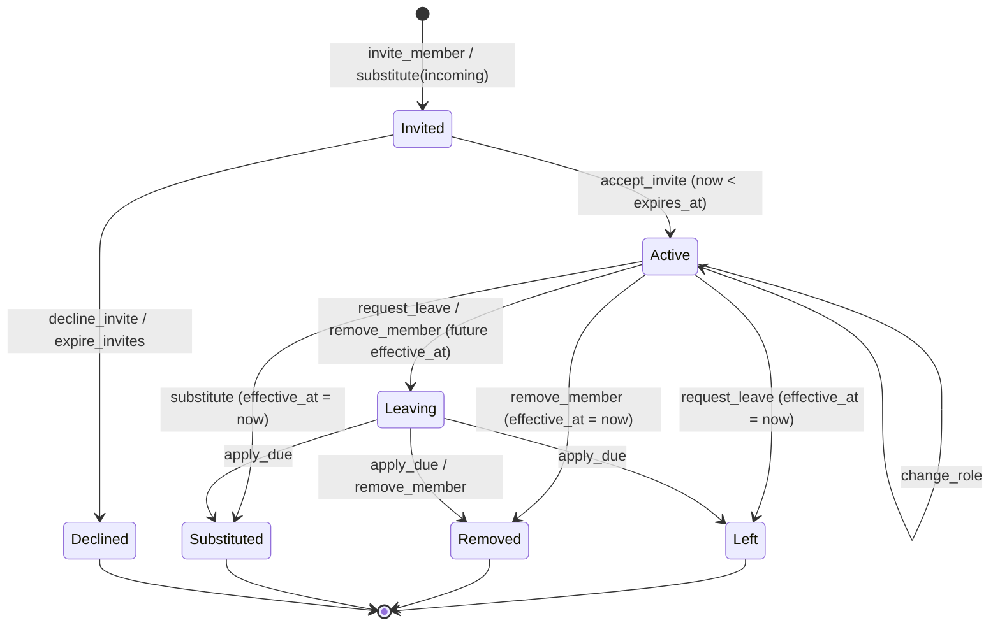

# CAPSTONE-047 — Team Membership Changes

> Design specification for issue #1395 (Teams track). Read the
> [capstone overview](./README.md) first. It defines tenants, `request_id`,
> `expected_version`, the shared errors (100–108) and the rollout plan.

## 1. Goal

Record **join, leave, removal, role change and substitution** of capstone team
members, with **effective dates**. Ownership, funding and review history must
keep pointing at the right people after the team changes.

The contract is the tamper-evident registry of *who held which role over which
time window*. It does not store why people joined or left, and it never deletes
history.

## 2. Data model

```rust
#[contracttype]
pub enum Role { Lead = 0, Member = 1, Advisor = 2, Mentor = 3 }

#[contracttype]
pub enum MemberStatus {
    Invited = 0,     // waiting for the invitee to accept
    Active = 1,
    Leaving = 2,     // leave/removal scheduled for a future effective_until
    Left = 3,        // terminal
    Removed = 4,     // terminal
    Substituted = 5, // terminal; replaced_by is set
    Declined = 6,    // terminal; invitation declined or expired
}

#[contracttype]
pub struct Membership {
    pub member: Address,
    pub role: Role,
    pub status: MemberStatus,
    pub effective_from: u64,          // ledger timestamp
    pub effective_until: Option<u64>, // set on leave/remove/substitute
    pub replaced_by: Option<Address>,
    pub reason_code: u32,             // coarse enum, see §5
    pub seq: u32,                     // stable per-team ordinal, never reused
}

#[contracttype]
pub struct Team {
    pub version: u32,                 // expected_version target
    pub active_count: u32,
    pub lead_count: u32,
    pub next_seq: u32,
    pub owner_hash: BytesN<32>,       // commitment to off-chain ownership record
}

// Storage keys (persistent)
DataKey::Team(tenant_id, project_id)                     -> Team
DataKey::Member(tenant_id, project_id, Address)          -> Membership
DataKey::MemberIndex(tenant_id, project_id)              -> Vec<Address> (≤ 24)
DataKey::RoleHistory(tenant_id, project_id, Address)     -> Vec<(Role, u64)> (≤ 8)
```

Notes:

- **Terminal records stay.** `Left`, `Removed` and `Substituted` records are
  never deleted. Escrow, reward and review records keep a stable
  `(tenant, project, member, seq)` to point at.
- **Re-joining.** A member who left and re-joins gets a **new** `seq`. The old
  record moves to `RoleHistory`, and the latest record is kept under the
  `Member` key.
- **Owner hash.** `owner_hash` commits to the off-chain ownership and IP record.
  Changing it is a charter concern ([CAPSTONE-049](./project-charters.md)), not a
  membership one.

## 3. Entrypoints

Every call takes `tenant_id`, `project_id`, `request_id` and
`expected_version`. The table shows the remaining arguments.

| Function | Args | Must authorize | Allowed when |
| --- | --- | --- | --- |
| `create_team` | `coordinator, lead, owner_hash` | coordinator | No team yet |
| `invite_member` | `actor, invitee, role, expires_at` | coordinator or Lead | Team non-terminal; invitee not `Active`/`Invited`; `expires_at ≤ now + 14d` |
| `accept_invite` | `invitee` | invitee | Status `Invited` and `now < expires_at` |
| `decline_invite` | `invitee` | invitee | Status `Invited` |
| `request_leave` | `member, effective_at, reason_code` | member | Status `Active` |
| `remove_member` | `coordinator, member, effective_at, reason_code` | coordinator | Status `Active` or `Leaving` |
| `change_role` | `actor, member, new_role` | coordinator; also the member when becoming Lead | Status `Active` |
| `substitute` | `coordinator, outgoing, incoming, effective_at` | coordinator **and** incoming | Outgoing is `Active`; incoming is not `Active`/`Invited` |
| `apply_due` | `(none)` | anyone | Processes changes with `effective_at ≤ now` (at most 8) |
| `expire_invites` | `(none)` | anyone | Marks `Invited` past `expires_at` as `Declined` |
| `get_team`, `get_member`, `list_members` | — | none (read) | — |

### Effective dates

- `effective_at` must satisfy `now ≤ effective_at ≤ now + 90 days`. Otherwise the
  call returns `InvalidEffectiveDate` (204).
- If `effective_at == now`, the change applies immediately.
- If it is in the future:
  - the status becomes `Leaving`, or for a substitution the outgoing member is
    marked `Leaving` and the incoming member `Invited`, with acceptance already
    recorded;
  - the change is queued in `DataKey::Pending(tenant, project)` (at most 8);
  - `apply_due` finalizes it once the date is reached.
- **Backdating is not allowed.** Effective dates can never be earlier than `now`.
  If the off-chain record says someone left last week, the on-chain
  `effective_until` is the time the change was recorded, and the backend keeps
  the real date privately.

## 4. Invariants (history protection)

1. **At least one Lead.** A team must always have `lead_count ≥ 1`. Leaving,
   removing, demoting or substituting the last Lead fails with
   `LastLeadRequired` (201), unless the same call promotes a successor (as
   `substitute` does).
2. **One record per address.** There is never more than one non-terminal
   `Membership` per `(tenant, project, address)`. A second invite returns
   `AlreadyMember` (200).
3. **Terminal is final.** Terminal statuses do not change. Re-joining creates a
   new record and `seq`.
4. **Bounded team size.** `active_count ≤ 12`, counting invited members. More
   returns `LimitExceeded` (104).
5. **No fund moves.** This contract never moves funds. Escrow or payout contracts
   use `get_member(..).effective_from/effective_until` to decide who was a
   beneficiary at settlement time. A member who leaves keeps any entitlements
   earned before `effective_until`, and settlement logic decides what those are.
6. **Pending review blocks removal.** A member with an open review attestation
   cannot be removed until that attestation is resolved: `remove_member` returns
   `PendingObligation` (203) while the backend-submitted `obligation_hold` flag
   is set for the member. The flag stores no reason. The coordinator clears it
   with `clear_hold`. **Open question:** whether holds should be set by the
   review contract directly once it exists.

## 5. Reason codes (public)

| Code | Name | Used by |
| --- | --- | --- |
| 0 | `UNSPECIFIED` | any |
| 1 | `VOLUNTARY` | `request_leave` |
| 2 | `SCHEDULE_OR_CAPACITY` | `request_leave` |
| 3 | `PROJECT_SCOPE_CHANGE` | leave, remove |
| 4 | `COORDINATOR_DECISION` | `remove_member`. Covers **all** conduct, safety and academic-integrity removals, so the ledger never shows the category. |
| 5 | `SUBSTITUTION` | `substitute` |

Any other value returns `InvalidArgument` (108).

## 6. State machine



Any pair not shown returns `InvalidTransition` (107).

## 7. Errors (200–249)

| Code | Name | Client action |
| --- | --- | --- |
| 200 | `AlreadyMember` | Address already has a non-terminal membership. Refresh the roster. |
| 201 | `LastLeadRequired` | Promote another Lead first, or use `substitute`. |
| 202 | `InviteNotPending` | Invite was already accepted, declined or expired. Re-invite. |
| 203 | `PendingObligation` | Resolve the open review or funding hold before removing. |
| 204 | `InvalidEffectiveDate` | Use `now ≤ effective_at ≤ now + 90d`. |
| 205 | `SelfAction` | Coordinators cannot substitute themselves, and incoming cannot equal outgoing. |

The common errors 1, 6 and 100–108 also apply.

## 8. Events

The payload prefix is `(schema_version, tenant_id, project_id)`.

| Topic (`chainvrs`, `team`, …) | Payload suffix |
| --- | --- |
| `created` | `(lead: Address, owner_hash)` |
| `invited` | `(invitee, role, expires_at)` |
| `joined` | `(member, role, effective_from, seq)` |
| `declined` | `(member, seq)` |
| `leaving` | `(member, effective_at, reason_code)` |
| `left` | `(member, effective_until, reason_code)` |
| `removed` | `(member, effective_until, reason_code)` |
| `role_chg` | `(member, old_role, new_role)` |
| `subst` | `(outgoing, incoming, effective_at)` |

Events contain no hashes of personal data, no free text and no off-chain ids.

## 9. Off-chain boundaries

| Concern | Lives in | On-chain trace |
| --- | --- | --- |
| Member identity (name, email, student id) | Backend database | `Address` only |
| Mapping wallet ↔ user account | Backend (verified by signed challenge) | none |
| Reason for leaving / removal details | Backend, access-controlled | `reason_code` |
| Real-world effective date if it differs from the ledger date | Backend | `effective_until` = time recorded |
| Ownership / IP split | Backend + charter | `owner_hash` |
| Notifications to teammates | Backend, triggered by indexed events; deduplicated by `(tx_hash, event_index)` | events |

## 10. Test plan (`src/test/membership.rs`)

- **Authorization trees**
  - `invite_member` by a Lead succeeds; by a plain Member it fails with 1.
  - `substitute` asserts that **both** the coordinator and the incoming member
    appear in `env.auths()`.
  - A coordinator from tenant B gets 1 (or 105) against a tenant A team.
- **Replay**
  - `accept_invite` twice with the same `request_id` produces one `joined` event
    and `active_count` +1 only.
  - The same `request_id` with a different role returns 101.
- **Stale version.** Two coordinators read v3. The first `remove_member`
  succeeds; the second returns 102.
- **Transitions.** A table test covers all `MemberStatus` × entrypoint pairs.
- **Expiry and dates**
  - Accept at `expires_at − 1` succeeds; at `expires_at` it returns 103.
  - `effective_at = now + 90d` succeeds; `+90d+1` returns 204; `now − 1`
    returns 204.
  - `apply_due` at boundary timestamps.
- **Invariants**
  - The last Lead leaving returns 201.
  - `substitute` of the last Lead with an incoming Lead succeeds.
  - Re-joining after `Left` creates a new `seq` and keeps the old record in
    `RoleHistory`.
- **Storage bounds**
  - 12 active members, then the 13th invite returns 104.
  - 8 pending changes, then the 9th returns 104.
  - The `RoleHistory` cap is honored.
- **Event schemas.** Exact topic and payload match for each event.
- **Error codes.** Numeric assertions for 200–205.
- **Budget.** The worst case is `apply_due` with 8 pending changes on a 12-member
  team. It must stay under CPU and memory thresholds, which are recorded in the
  test when it is first implemented.
- **Upgrade.** v1 records survive an upgrade, and `get_member` output is
  unchanged.

## 11. Rollout / rollback specifics

- **Backfill.** Existing off-chain teams are backfilled with `create_team` and
  `invite_member`/`accept_invite` signed by the real members. The coordinator
  cannot add someone as `Active` without that member's signature. Teams whose
  members have not signed stay off-chain until they do.
- **Rollback.** Follows the overview: pause, then switch off the backend flag.
  Pending scheduled changes resume through `apply_due` after unpausing. Changes
  whose `effective_at` passed during the pause apply at unpause time, and the
  backend records the real-world date privately.

## 12. Dependencies and related work

- Required by [CAPSTONE-048](./team-rematching.md), which fills seats through
  `substitute` and `invite_member` internally, and by
  [CAPSTONE-049](./project-charters.md), which snapshots the active members as
  required signers.
- Escrow and reward contracts may read `get_member` for beneficiary checks.
  Wiring that up is a separate change.
- Other repositories: backend membership API, effective-date scheduler, wallet
  linking; frontend roster and membership-change flows (see
  [overview §6](./README.md#6-corresponding-work-in-other-repositories)).
