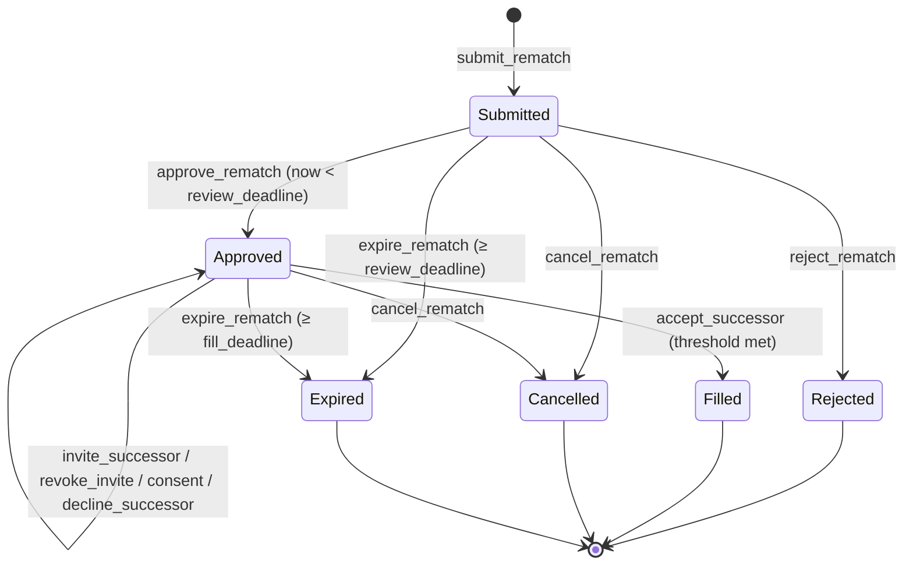

# CAPSTONE-048 — Team Rematching Workflow

> Design specification for issue #1396 (Teams track). Read the
> [capstone overview](./README.md) and [CAPSTONE-047](./team-membership.md)
> first. Rematching fills seats through the membership logic.

## 1. Goal

Handle **skill gaps** and **departures**:

1. A team member or Lead submits a **request**.
2. A tenant **coordinator reviews** it.
3. The coordinator issues **successor invitations**.
4. The team commits to a **continuity plan**.
5. **Consent** is recorded from the successor and from the team.

On-chain, this is a small state machine. It proves that the process was
followed, and it makes sure that a seat is filled **exactly once**.

## 2. Data model

```rust
#[contracttype]
pub enum RematchKind { SkillGap = 0, Departure = 1 }

#[contracttype]
pub enum RematchStatus {
    Submitted = 0,
    Approved = 1,    // coordinator approved; invitations can be issued
    Rejected = 2,    // terminal
    Filled = 3,      // terminal; successor joined
    Cancelled = 4,   // terminal; requester or coordinator withdrew
    Expired = 5,     // terminal; review or fill deadline passed
}

#[contracttype]
pub struct RematchRequest {
    pub id: u32,                         // per-project counter
    pub kind: RematchKind,
    pub requester: Address,
    pub departing: Option<Address>,      // required for Departure
    pub seat_role: Role,                 // role of the seat being filled
    pub gap_hash: BytesN<32>,            // commitment: skill-gap / departure brief
    pub continuity_plan_hash: Option<BytesN<32>>, // set by approve_rematch
    pub status: RematchStatus,
    pub review_deadline: u64,            // submitted_at + 14d
    pub fill_deadline: Option<u64>,      // approved_at + 30d
    pub consents: Vec<Address>,          // team members who consented (≤ 12)
    pub consent_threshold: u32,          // snapshot at approval
    pub version: u32,
}

#[contracttype]
pub enum InviteStatus { Pending = 0, Accepted = 1, Declined = 2, Revoked = 3, Expired = 4 }

#[contracttype]
pub struct SuccessorInvite {
    pub invitee: Address,
    pub status: InviteStatus,
    pub expires_at: u64,                 // ≤ min(now + 7d, fill_deadline)
}

DataKey::Rematch(tenant_id, project_id, id)        -> RematchRequest
DataKey::RematchInvites(tenant_id, project_id, id) -> Vec<SuccessorInvite> (≤ 3)
DataKey::OpenRematches(tenant_id, project_id)      -> Vec<u32> (≤ 2)
```

### Hash domain tags

| Field | Tag | Preimage held off-chain |
| --- | --- | --- |
| `gap_hash` | `"chainverse:capstone:gap:v1"` | Required skills, context, departure brief |
| `continuity_plan_hash` | `"chainverse:capstone:continuity:v1"` | Handover tasks, repo and doc access, timeline |

## 3. Entrypoints

Every mutating call takes `tenant_id`, `project_id`, `request_id` and
`expected_version`. For calls on an existing request, `expected_version` is the
request's version.

| Function | Args | Must authorize | Allowed when |
| --- | --- | --- | --- |
| `submit_rematch` | `requester, kind, departing, seat_role, gap_hash` | requester (active member) | Fewer than 2 open requests. For `Departure`, `departing` is active and is the requester, or the requester is a Lead. No other open request for the same `departing`. |
| `approve_rematch` | `coordinator, continuity_plan_hash` | coordinator | `Submitted` and `now < review_deadline` |
| `reject_rematch` | `coordinator, reason_code` | coordinator | `Submitted` |
| `cancel_rematch` | `actor` | requester or coordinator | `Submitted` or `Approved` |
| `invite_successor` | `coordinator, invitee, expires_at` | coordinator | `Approved`. Fewer than 3 invites. Invitee not already on the team. |
| `revoke_invite` | `coordinator, invitee` | coordinator | Invite `Pending` |
| `consent` | `member` | member (active, not `departing`) | `Approved`. Not consented yet. |
| `accept_successor` | `invitee` | invitee | Invite `Pending`, not expired. Request `Approved`. Consent threshold met. |
| `decline_successor` | `invitee` | invitee | Invite `Pending` |
| `expire_rematch` | `id` | anyone | Past `review_deadline` (Submitted) or `fill_deadline` (Approved) |

### Consent rule

- `consent_threshold = ceil(eligible / 2)`, where *eligible* means active members
  other than `departing`. It is snapshotted at approval and is at least 1.
- **Approval does not count as consent.** The coordinator's approval is separate
  from team consent.
- **Successor consent** is the invitee's own `require_auth` in
  `accept_successor`.
- **Departing member consent** is implicit when they submitted the request. If a
  Lead submitted on their behalf, the departing member must also call `consent`.
  Their consent is tracked but does not count toward the threshold. **Open
  question:** is this too strict for members who have stopped responding? The
  alternative is to let the coordinator bypass this consent with a
  `COORDINATOR_DECISION` reason code.

### What `accept_successor` does (atomically)

1. Marks this invite `Accepted` and every other `Pending` invite `Revoked`.
2. **Departure:** runs the CAPSTONE-047 `substitute(departing → invitee)` path
   with `effective_at = now`. The CAPSTONE-047 invariants apply. In particular,
   if the departing member is the last Lead and `seat_role == Lead`, the
   successor becomes the Lead.
3. **SkillGap:** runs the CAPSTONE-047 join path, so the invitee becomes `Active`
   with `seat_role`.
4. Sets the request to `Filled` and removes it from `OpenRematches`.

The team version and the request version are both bumped. If any step fails,
the whole transaction reverts.

## 4. Single-fill guarantee

Duplicate fills are prevented in several ways:

- **Status checks.** Only an `Approved` request with a `Pending` invite can be
  accepted. After the first acceptance, the request is `Filled`, and any other
  acceptance fails with `RequestNotOpen` (251).
- **Stale versions.** Two invitees accepting in the same ledger are ordered. The
  second sees the request `Filled`, or a bumped version, which returns 102.
- **Replays.** A replayed `accept_successor` with the same `request_id` returns
  the original `Ok` and emits no event.
- **One open request per departure.** `OpenRematches` blocks a second open
  request for the same `departing` member with `DuplicateRequest` (250).

## 5. State machine



When a request reaches a terminal status other than `Filled`, all `Pending`
invites become `Revoked`, or `Expired` if the request expired.

## 6. Errors (250–299)

| Code | Name | Client action |
| --- | --- | --- |
| 250 | `DuplicateRequest` | An open request already exists for this departing member. Use it. |
| 251 | `RequestNotOpen` | Request is terminal. Submit a new one. |
| 252 | `ConsentThresholdNotMet` | Collect more team consents before the successor accepts. |
| 253 | `AlreadyConsented` | No action needed. |
| 254 | `InviteLimit` | Revoke a pending invite before adding another. |
| 255 | `InviteNotPending` | Invite was accepted, declined, revoked or expired. |
| 256 | `DepartingMismatch` | `departing` is missing, is not active, or is not allowed for this requester. |
| 257 | `IneligibleSuccessor` | Invitee is already on the team or is the departing member. |

Membership errors 200–205 can also come back from the seat-fill step, along with
the common errors.

## 7. Events

The topic is `(chainvrs, rematch, …)`. The payload prefix is
`(schema_version, tenant_id, project_id, id)`.

| Event | Payload suffix |
| --- | --- |
| `submitted` | `(kind, requester, departing, seat_role, gap_hash)` |
| `approved` | `(coordinator, continuity_plan_hash, fill_deadline, consent_threshold)` |
| `rejected` | `(coordinator, reason_code)` |
| `cancelled` | `(actor)` |
| `invited` | `(invitee, expires_at)` |
| `inv_rev` | `(invitee)` |
| `consented` | `(member, consent_count)` |
| `declined` | `(invitee)` |
| `filled` | `(successor, departing)` |
| `expired` | `(previous_status)` |

The `team` events from CAPSTONE-047 (`subst` or `joined`) are also emitted when a
seat is filled.

## 8. Off-chain boundaries

| Concern | Lives in | On-chain trace |
| --- | --- | --- |
| Skill-gap description, departure reason, health or personal circumstances | Backend, coordinator-only access | `gap_hash` |
| Candidate search, matching scores, candidate profiles | Backend | none (only the invited `Address`) |
| Coordinator review notes | Backend | `reason_code` on reject |
| Continuity plan document | Backend / project workspace | `continuity_plan_hash` |
| Notifications (invite sent, consent needed) | Backend, from indexed events; deduplicated by `(tx_hash, event_index)` | events |
| Uninvited candidates | Backend only | **never** on-chain |

Only the addresses of people **actually invited** are written to the ledger.
Shortlists and rejected candidates stay off-chain.

## 9. Test plan (`src/test/rematch.rs`)

- **Authorization trees**
  - `approve_rematch` by a Lead fails with 1.
  - `invite_successor` by a non-coordinator fails with 1.
  - `accept_successor`'s auth tree contains only the invitee.
  - A cross-tenant coordinator gets 1 or 105.
- **Replay and concurrency**
  - A double `accept_successor` with the same `request_id` gives one `filled`
    event and one membership change.
  - Two different invitees accepting in sequence: the first is `Filled`, the
    second gets 251.
  - A double `consent` returns 253.
  - Same `request_id` with different args returns 101.
- **Transitions.** A table test over every `RematchStatus` × entrypoint pair.
- **Expiry**
  - Approve at `review_deadline − 1` succeeds; at `review_deadline` it returns
    103.
  - Invite acceptance at `expires_at` boundaries.
  - `fill_deadline` expiry revokes pending invites.
- **Consent**
  - Threshold math for 1, 2, 5 and 12 eligible members.
  - The departing member's consent does not count.
  - Accepting below the threshold returns 252.
- **Integration with 047**
  - A Departure fill gives `departing → Substituted` and `invitee → Active`.
  - Last-Lead departure with `seat_role = Lead` keeps `lead_count = 1`.
  - A full team (12) blocks a SkillGap fill with 104.
- **Bounds**
  - A third open request returns 104.
  - A fourth invite returns 254.
- **Events and errors.** Exact schemas; numeric codes 250–257.
- **Budget.** Worst case is `accept_successor` with 3 invites and a 12-member
  team, plus the substitution.
- **Upgrade.** Open requests and invites survive an upgrade, and can still be
  filled afterwards.

## 10. Rollout / rollback specifics

- **Order.** Ship after CAPSTONE-047 is live for a tenant. Rematching requires
  the team to exist on-chain.
- **Pause.** While paused, the deadlines keep running. After unpausing, the
  coordinator can call `extend_deadline` once per request, adding at most the
  paused duration. That duration is stored in instance storage by
  `set_paused(false)`.
- **Backend fallback.** With the flag off, rematching runs database-only.
  Requests started off-chain are **not** migrated on-chain mid-flight. They
  finish off-chain, and only the resulting membership change is recorded through
  CAPSTONE-047.

## 11. Dependencies and related work

- **Depends on:** [CAPSTONE-047](./team-membership.md) (substitute and join
  paths, active-member snapshot).
- **Other repositories:** backend rematch queue, coordinator review UI API,
  continuity-plan storage and hashing, candidate matching (off-chain only);
  frontend request form, coordinator review, successor accept, consent prompts.
